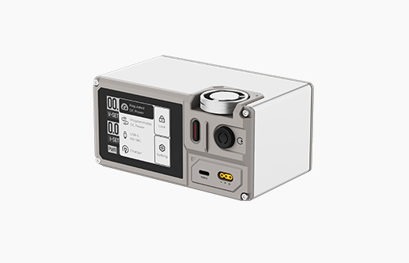

# mp305-cli

[简体中文](README.md) · **English**

[](https://github.com/chenkaiyao/mp305a-cli/actions/workflows/ci.yml?query=branch%3Amain)

**A command-line tool for agents working with ISDT MP305A and MP305B bench power supplies.** Run it on the host connected to the power supply over USB HID. Agents can read voltage, current, and output state, set approved DC output values, and verify changes by reading the device state back.




Rear connector comparison from the [official ISDT MP305 product page](https://www.isdt.co/mp305.html).

## Agent quick start

Read [AGENTS.md](AGENTS.md) before operating the power supply. On the Windows host connected to an MP305A or MP305B, run the built executable from the repository root.

```powershell
.\target\release\mp305-cli.exe --json list
.\target\release\mp305-cli.exe --json info
.\target\release\mp305-cli.exe --json status
```

The CLI selects a single connected device automatically. If multiple devices are connected, use the ID from `list` with `--device <id>` on subsequent commands. The ID is derived from the local HID path and may change when you switch USB ports or hosts.

Check for exit code `0` and `ok: true` in the JSON response before using `data`. On failure, read `error.code` and `error.message`. Command-line syntax errors are reported on stderr.

`voltage_v` and `current_a` are measured values. `set_voltage_v` and `current_limit_a` are setpoints. Use `output_enabled` to confirm the output state.

## Control the output

The bench operator maintains `mp305-limits.json` next to the executable. Restrict write access to authorized operators and check the limits whenever the device under test changes. MP305A can still use the legacy `mp305a-limits.json` when the new file is absent.

| Field | Description |
| --- | --- |
| `device_id` | Target device ID returned by `list`. |
| `max_voltage_v` | Maximum voltage allowed by the device under test, as a decimal string. |
| `max_current_a` | Maximum current allowed by the device under test, as a decimal string. |

- `set --voltage <V> --current <A>` updates both setpoints while the output is off. Voltage accepts up to two decimal places and current up to three.
- `on` enables output using the current setpoints. The supply must be in DC mode with a valid limits file.
- `off` disables DC output and works without a limits file. Use the front panel in other modes.

The CLI reads the state back after each write. Follow the device's front-panel prompt to resume local operation after remote control.

Agents may write only when the user authorizes hardware operation. Use voltage and current values specified by the user or an approved test configuration. If the CLI returns `state_unknown` or `verification_failed`, stop further writes and confirm the actual state on the front panel.

## Build and CI

```text
cargo test --locked
cargo build --release --locked
```

The Windows executable is `target\release\mp305-cli.exe`. On Linux and macOS, the binary is `target/release/mp305-cli`. Local builds on Ubuntu require `libudev-dev` and `pkg-config`.

The badge shows the GitHub Actions status for `main`. CI runs unit tests, builds the release binary, and checks the version command on Windows, Linux, and macOS. USB hardware verification to date covers device enumeration, read-only queries, and rejection of output enablement without a limits file on an MP305A connected to Windows x64. MP305B support uses the shared protocol and awaits hardware verification.

## Project resources

- [Agent instructions (Chinese)](AGENTS.md)
- [Protocol and acceptance criteria (Chinese)](docs/mp305-cli%20%E9%9C%80%E6%B1%82%E6%96%87%E6%A1%A3.md)
- [Changelog (Chinese)](CHANGELOG.md)
- [MIT License](LICENSE)
