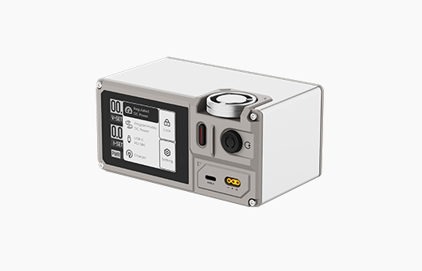

# mp305a-cli

[](https://github.com/chenkaiyao/mp305a-cli/actions/workflows/ci.yml?query=branch%3Amain)

**面向 Agent 的 ISDT MP305A 电源命令行工具。** Agent 在连接电源的本机通过 USB HID 调用，读取电压、电流和输出状态，按工位批准的参数设置直流输出，并通过设备回读确认结果。




背部接口对比图来自 [ISDT 官方 MP305 产品页](https://www.isdt.co/mp305.html)。

## Agent 快速开始

Agent 应先阅读 [AGENTS.md](AGENTS.md)。在连接 MP305A 的 Windows 主机上，从仓库根目录调用已构建的 EXE。

```powershell
.\target\release\mp305a-cli.exe --json list
.\target\release\mp305a-cli.exe --json info
.\target\release\mp305a-cli.exe --json status
```

连接一台时自动选择。连接多台时，从 `list` 获取 ID，并为后续命令加上 `--device <id>`。ID 根据本机 HID 路径生成，换端口或换电脑后可能变化。

Agent 应同时检查退出码为 `0` 和 JSON 中的 `ok: true`，再读取 `data`。失败时读取 `error.code` 和 `error.message`。参数语法错误由命令行解析器通过 stderr 报告。

区分 `voltage_v`、`current_a` 两个实测值，与 `set_voltage_v`、`current_limit_a` 两个设定值。用 `output_enabled` 确认输出状态。

## 控制输出

负责人在 EXE 同目录维护 `mp305a-limits.json`，填写以下字段。部署时应通过文件权限限制修改者，并在更换被测硬件后核对上限。

| 字段 | 说明 |
| --- | --- |
| `device_id` | `list` 返回的目标设备 ID。 |
| `max_voltage_v` | 被测硬件允许的最高电压，使用十进制字符串。 |
| `max_current_a` | 被测硬件允许的最大电流，使用十进制字符串。 |

- `set --voltage <V> --current <A>` 在输出关闭时更新两项设定值。电压最多两位小数，限流最多三位小数。
- `on` 使用当前设定值。设备必须处于直流模式，且上限配置有效。
- `off` 关闭直流输出，保护配置缺失时仍可调用。其他模式请使用前面板。

每次写入都会回读确认。控制流程取得远程控制后，按设备面板提示恢复本地操作。

Agent 只在用户授权实机操作时执行写入，电压和限流必须来自用户指定值或已批准的测试配置。收到 `state_unknown` 或 `verification_failed` 后停止后续写入，通过前面板确认实际状态。

## 构建与 CI

```text
cargo test --locked
cargo build --release --locked
```

Windows 发布产物位于 `target\release\mp305a-cli.exe`。Linux 和 macOS 产物为 `target/release/mp305a-cli`。Ubuntu 本地构建需要 `libudev-dev` 和 `pkg-config`。

顶部徽章显示 GitHub Actions 在 `main` 上的 CI 状态。CI 在 Windows、Linux 和 macOS 上执行单元测试、发布构建与版本命令检查。实机 USB 验收单独进行，目前已验证 Windows x64 上的设备枚举、只读查询和缺少限值时的上电拒绝。

协议和验收条件见 [项目需求文档](docs/mp305a-cli%20%E9%9C%80%E6%B1%82%E6%96%87%E6%A1%A3.md)。

## 项目资料

- [Agent 调用说明](AGENTS.md)
- [更新日志](CHANGELOG.md)
- [MIT 许可证](LICENSE)
